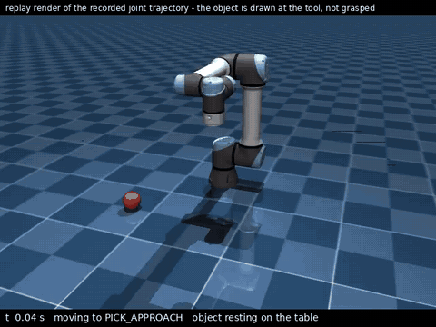
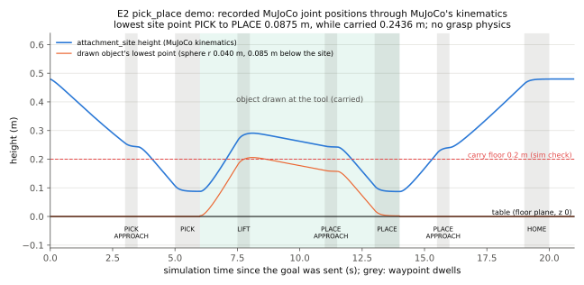
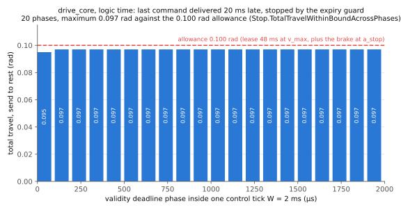
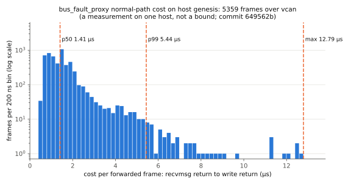
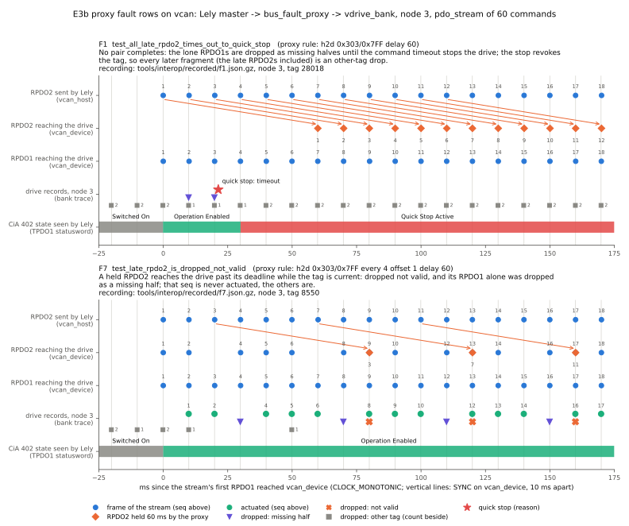

# robotics

A simulation-based robot system runtime, built in stages.

- **Done (E0, E1, E2):** a pinned ROS 2 Jazzy toolchain with CI, a cyclictest baseline, a
  ROS-free C++ core of command and permit contracts, checked by an independent judge in
  logic time, and the UR5e in MuJoCo under the stock JointTrajectoryController (no permit or
  generation guarantee).
- **In progress (E3):** E3a, the CANopen wire contract and a ROS-free drive core, is done.
  E3b puts six of those drives on virtual CAN as a process, adds a bus fault proxy, and checks
  them against an independent CANopen master (Lely) (see below).
- **Planned (E3c onward):** a second independent stack (CANopenNode), a C++ hardware
  abstraction layer on ros2_control and MuJoCo, and real-time loop measurement.

## Status

| Stage | State |
|---|---|
| E0 environment, dev and runtime images, CI | partial: toolchain, CI, environment manifest, cyclictest baseline, and the MuJoCo plugin and Menagerie model done; CANopen peers, supervisor, DDS, Zephyr and PREEMPT_RT checks are open and run in the stage that needs them |
| E1 command and permit contracts, independent judge | done |
| E2 official plugin baseline | done: stock JTC baseline; no permit/generation guarantee |
| E3 | in progress: E3a wire contract and drive core done; E3b bus processes, fault proxy and Lely interop done; E3c-E3d planned |

## E2 baseline

The Menagerie UR5e in MuJoCo under ros2_control, driven by the stock JointTrajectoryController.
After `docker compose run --rm dev tools/ci/run_checks.sh` has built the workspace:

    docker compose run --rm dev bash -c 'source install/release/setup.bash && ros2 launch robot_bringup ur5e_baseline.launch.py'

The launch is headless by default; `headless:=false` opens the MuJoCo viewer (needs a display).
Pass `camera:=true` to publish the `overview` camera on `/overview/image_raw`. The recording [docs/media/e2-baseline.mp4](docs/media/e2-baseline.mp4)
(640x480, from that camera; `tools/sim_checks/record_motion.py`) shows the arm leaving the home pose
and returning to it.

The simulation checks (`tools/sim_checks`) show that:

- the joints, actuators and controller joints map to each other by name;
- the arm starts at the home pose;
- a normal goal is accepted and reached within 0.05 rad at its end;
- a pick-and-place-shaped goal reaches each of its five waypoints within 0.05 rad (see
  [E2 evidence](#e2-evidence));
- out-of-range goals behave as measured below.

Out-of-range behaviour, measured with the stock JointTrajectoryController 4.42.1 on the MuJoCo UR5e:
A goal of 6.5 rad for `wrist_3_joint` was accepted, passed through unchanged as the controller
output, and aborted with GOAL_TOLERANCE_VIOLATED (-5), while the MuJoCo joint stayed at or below
6.2815 rad. The actuator `ctrlrange` (6.2831) is below the joint `range` (6.28319), so this run
does not show which of the two held the joint; the project HAL (E3) owns limit enforcement. A
goal of 3.5 rad for `elbow_joint` from the home pose was also passed through and aborted with
GOAL_TOLERANCE_VIOLATED (-5); the elbow stopped at about 2.89 rad, short of its 3.1415 rad limit.
A standalone MuJoCo 4.0.1 run of the same scene showed the elbow actuator at its force limit and
`upper_arm_link` touching `wrist_3_link`.

Pinned versions: ROS snapshot 2026-10-05, `mujoco_ros2_control` 0.1.2,
`joint_trajectory_controller` 4.42.1, MuJoCo Menagerie commit
`370c43965323c0944b433b202aac5058b5f907a9` (files verified by SHA-256).

This path uses the stock JointTrajectoryController. It accepts goals on its own action and topic interfaces, and nothing outside it can prove which goal produced a given output, so E2 claims no permit or generation guarantee. Those claims start with the project's own controller in E3.

### E2 evidence

A replay render of the recorded joint trajectory: the arm moves as MuJoCo reported it under the
plugin, and the red ball is not grasped (there is no grasp physics; the render draws it at the
tool only while it is carried, and on the table before and after). The goal is one
FollowJointTrajectory goal through five waypoints, approach, pick, lift, place approach and place,
with a dwell at each, followed by a retreat to HOME
([MP4](docs/media/e2-pick-place-replay-render-of-the-recorded-joint-trajectory.mp4)).

How it is made: `mujoco_ros2_control` 0.1.2 offers no runtime weld or mocap control (its services
are `reset_world`, `set_free_joint_state`, `set_pause` and `step_simulation`, and the scene has no
free body), so the live run has no object. `record_motion.py --demo pick_place` records the
MuJoCo joint positions from `/mujoco_actuators_states` of the live run and refuses a recording that
fails the check's conditions; `tools/evidence/pick_place_replay.py` sets them, frame by frame, on
the same installed scene with the MuJoCo 3.12.0 Python bindings (the version the plugin links) and
adds the ball kinematically. The floor plane the arm stands on (z = 0) is the table.

The simulation check `test_pick_place_trajectory_reaches_each_waypoint` sends the same goal and
judges the 500 Hz MuJoCo joint positions: every waypoint is reached within 0.05 rad during its
dwell; by the `attachment_site` height from MuJoCo's own kinematics, the site comes low enough at
PICK and PLACE for the ball to be within 0.02 m of the table, the ball never goes more than 0.01 m
into the table between them, and the site stays above 0.20 m from LIFT to PLACE_APPROACH. From the
committed recording (100 Hz):

    python3 tools/evidence/pick_place_replay.py           # prints the values, redraws the SVG
    python3 tools/evidence/pick_place_replay.py --video   # also renders the MP4 and the GIF

the largest joint error at its best point in each dwell was 0.0081 to 0.0122 rad; the lowest site
point between PICK and PLACE was 0.0875 m, which puts the ball's lowest point 0.0025 m above the
table; from LIFT to PLACE_APPROACH the site stayed at or above 0.2436 m. The script prints the command that
records the trajectory again. The generic pytest stage checks that the recording is of the current
waypoints and passes the check's conditions, that the plot draws MuJoCo's site height for every
sample, that the ball rests, rides only between the two dwells and rests again, and that the GIF
fits in 3 MB; the MP4 and GIF are encoder output and are not compared byte for byte.

## What E1 proves today (logic time, no robot, no ROS)

- A command is applied only while `now < valid_until` as it was sent, and never outlives its
  motion permit.
- A permit is renewed only on observed controller progress and fresh feedback, only by the
  manager that issued it; an expired permit is never renewed.
- Output from an old trajectory generation is blocked after a new execution starts.
- After an injected fault, motion resumes only after an explicit Reset and then an explicit
  Enable, with a new session and generation.
- Each backend profile states, per guarantee, whether the device supports it, the host
  provides it, it does not apply, or it is unknown or unsupported; `missing_capabilities()`
  lists what a backend lacks for a given set of requirements. Nothing refuses activation on
  that list yet: the activation path arrives with the project's own HAL (E3).

The judge (`tools/oracle`) is written in Python and does not import the C++ code. It judges
the command as sent, the faults the scenario injected, and evidence that each scenario reached
the path it claims to test. Each rule has a deliberate defect in the harness that it must catch:

| Scenario | Defect | Judge result |
|---|---|---|
| manager stall | expiry off by one | FAIL |
| generation switch | generation check skipped | FAIL |
| fault, reset, re-enable | enable without request | FAIL |
| fault, reset, re-enable | old session and generation reused | FAIL |
| fault, reset, re-enable | pre-fault frame redelivered and applied | FAIL |
| normal | apply events dropped | INCONCLUSIVE |

## E3a wire contract and drive core

E3a fixes the CAN wire contract of the virtual drive and implements the drive side in ROS-free
C++ (`src/canopen_codec`, `src/drive_core`). It runs in logic time; no bus is involved yet.

What the contract fixes:

- One EDS (`config/od/vdrive_arm.eds`) is the single source of the object dictionary; the C++
  header is generated from it.
- Every executed command carries a tag issued by the drive. A master obtains the tag through an
  SDO commit that is bound by a CRC; each command is two PDO fragments bound to that tag and a
  sequence number, and the drive pairs fragments only on equal tag and sequence.
- A command's validity is bounded by a lease of at most 48 ms. The drive never actuates an
  expired command, and a tag lives at most 5 minutes.
- SYNC timeline: RPDOs received between SYNC k and k+1 are actuated at SYNC k+1; TPDOs are
  sampled at SYNC k. Loss of SYNC or of commands, an integrity violation or leaving NMT
  Operational starts a quick stop.
- TPDO2 `applied_seq` (with TPDO3 `applied_tag`) reports the command the drive accepted for
  actuation at that SYNC: drive verification, not plant motion. Position and velocity in the
  same sample predate it; the joint first follows it at the next W tick. Plant application is
  reported by `plantd` (E5).
- Quick stop is an achieved deceleration ramp, not a switch of state. A stop not confirmed at
  rest within 0.112 s is reported unconfirmed (a fault reaction then ends in Fault). While the
  latest stop is unconfirmed, the drive refuses every entry into Operation Enabled, also after
  Fault Reset and a new commit; only observing the joint at rest (below 0.01 rad/s for 5 ticks)
  clears it.
- A command pair dropped because the drive was not Operation Enabled, or a sequence number
  evicted from the full eight-slot assembly window, binds its target to its sequence number:
  another target for it is an integrity violation. A master re-sends the command under a new
  sequence number (host obligation 8).
- A policy stop sets a latch that survives reset node and reset communication and clears only
  through an explicit policy reset.
- Fault layers separate controlled faults from torque loss; after torque loss the drive stays in
  Fault until the process restarts.
- Commands reach the drive by PDO only. 0x6040, 0x607A, 0x2020 and 0x2021 are `rww` in the EDS
  so that RPDOs can map them, but an SDO write to them is refused with abort 0x06010000.
  Parameters the drive never changes at run time (0x1005, 0x1017, the PDO COB-IDs and
  transmission types, 0x605A, 0x605E, 0x6085) are `const`, so a write is refused as read-only.
- The SDO server serves expedited transfers only. A segmented or block request, or any other
  client command specifier it does not serve, is answered with abort 0x05040001. An expedited
  download with the size indicator clear (command byte 0x22) is accepted: the object's own size
  applies, and data bytes beyond it must be zero.

Which tool checks what:

| Check | Tool | What it covers |
|---|---|---|
| Wire bytes | Python wire encoder (`tools/od/wire.py`), independent of the C++ codec and of the shared EDS loader | Golden vectors (`tools/od/make_golden.py`) that the C++ codec must reproduce byte for byte |
| EDS syntax | Lely `dcfchk` 2.3.5 (`tools/od/tests/test_dcfchk.py`) | Calibrated on five broken copies: catches a missing sub-object (0x1018:01) and the `0x80+$NODEID` default form it cannot parse; misses PDO mappings that are 72 bits long, map an unmappable object, or map a read-only object into an RPDO. No other defect class is calibrated |
| EDS contract | project validator and `tools/od/tests/test_od.py` | The PDO mapping rules `dcfchk` misses, and every object, type, default and PDO layout of the contract, restated by hand in the test |
| CiA 402 transitions | table written from the standard text, in the drive core tests | The transitions of the state machine |
| Bandwidth | `tools/od/bandwidth.py` | Frame count and occupancy computed from the EDS |

No independent CiA 402 implementation was available, so the CiA 402 state machine is checked
only against the project's table from the standard text. Interop with Lely and with CANopenNode
is E3b and E3c and covers the standard part only.

Measured and computed:

- Total travel of the last command, measured from the moment it is sent (its deadline minus the
  48 ms lease) to rest, with the validity deadline swept over 20 phases of one control tick W
  (`TotalTravelWithinBoundAcrossPhases` in `src/drive_core/test/test_drive_loop.cpp`, which pins
  the value): maximum 0.097 rad, the lease interval (24 ticks at v_max, 0.048 rad) plus the
  braking ramp from v_max (0.049 rad), against an allowance of 0.100 rad (lease 48 ms at v_max
  1 rad/s, a_stop 10 rad/s^2). These values are project-declared, not industry values. All 20
  phases are drawn under [E3a evidence](#e3a-evidence).
- Bandwidth: the bus-load table under [E3a evidence](#e3a-evidence), computed from the EDS. It is
  a computed bound: vcan does not show physical arbitration delay.

Residual risks and deviations:

1. Across a drive reboot, a fragment that survived in some queue through the 100 ms quarantine
   could carry a tag equal to one issued by the new boot (the tag starts pseudo-randomly per
   boot within a process, about 2^-16). If its sequence also matches and the fresh RPDO1 of
   that sequence is lost, an old target could pair with a fresh RPDO2. In the project harness
   the bus proxy bounds delay so this cannot occur there.
2. The tag start of a boot is spread uniformly over 1..65535 (`exec_tag_start`), and a boot can
   issue the tags from its start up to 65535, that is 65536 - start tags. Fewer than 100 tags
   are left exactly when the start is above 65436: 99 of 65535 values, about 0.151 % of boots.
   Such a boot runs out of tags sooner and then needs a reset node (availability, not safety).
3. With the policy latch set, Enable Operation in Ready to Switch On is ignored instead of
   taking only transition 3. This is intended and conservative.
4. Quick-stop option 6 with transition 16 disabled while latched is a documented project
   restriction.
5. SDO writes to command objects are refused; commands travel by PDO only.
6. A tag lives at most 5 minutes of drive time, even while commands stream, so trajectories
   longer than 5 minutes are out of scope. When the tag expires mid-stream, every later fragment
   is of a dead tag, nothing actuates, and the command timeout starts a policy stop
   (`Lifetime.StreamPastTagLifetimeEndsInTimeoutStop`). A commit is refused in Operation Enabled
   while a command is active, so renewing the tag takes Disable Operation, a new commit and
   Enable Operation.
7. drive_core produces no heartbeat and no EMCY. 0x1017 states the 100 ms heartbeat period that
   the process hosting the drive is to produce (E3b).
8. Host obligation: a master must never reuse a command sequence number for a different target
   within one tag: a new target always takes a new sequence number. The drive binds each
   sequence number to one target and treats a different target for a used sequence number as an
   integrity violation; but if a master re-sends a sequence number with a new target and that
   RPDO1 is lost while a delayed copy of the earlier RPDO1 arrives, the drive cannot tell it from
   a legitimate re-send and would actuate the earlier target under the new deadline. A re-sent
   sequence number must also be byte-identical in both RPDOs: a new deadline or a new target
   takes a new sequence number. Otherwise a late fragment of the original that differs from the
   re-send (an RPDO2 whose deadline is still open on arrival, or an RPDO1 with the earlier
   target) is a second payload for that sequence number: an integrity violation that latches the
   policy stop and needs a policy reset.

Decision index (the `D<n>` references in code comments):

| # | Decision |
|---|---|
| D1 | The EDS is the single source of the object dictionary; Lely `dcfchk` lints it, a generator writes the C++ header |
| D2 | Units: int32 µrad for positions, int32 µrad/s for velocity |
| D3 | The drive issues a 16-bit exec_tag per commit from a per-boot counter; a tag lives at most 5 min; commits are refused for 100 ms after boot |
| D4 | RPDO1 (target, seq, tag) and RPDO2 (valid_until_us, seq, tag) are 8 bytes; RPDO3 is the controlword alone, 2 bytes; a frame whose DLC differs from its mapping is rejected |
| D5 | valid_until_us is host monotonic µs mod 2^32; accepted only if 0 < (until - now) mod 2^32 <= 48 000 |
| D6 | Replay safety comes from D3 and D5; RPDO1 actuates only paired with an open RPDO2 of the same tag and seq |
| D7 | RPDOs received between SYNC k and k+1 actuate at SYNC k+1; TPDOs are sampled at SYNC k; no SYNC for 3 T_bus stops; a SYNC sooner than T_bus/2 is ignored |
| D8 | Fragments pair on equal tag and seq; the newest complete pair actuates; two payloads for one seq are an integrity violation, detected at ingestion, stopping at the next W tick |
| D9 | Validity is checked at actuation and every W tick; no actuated command for 30 ms in Operation Enabled stops |
| D10 | Quick stop: option 6, a_stop 10 rad/s^2 achieved exactly; stop confirmed after 5 quiet ticks, unconfirmed after 0.112 s; no enable while unconfirmed |
| D11 | Policy stops latch until an explicit policy reset after a confirmed stop; normal disable needs no reset; torque loss is Fault without a ramp |
| D12 | NMT service matrix; reset communication keeps boot_id and the tag allocator; leaving Operational while Operation Enabled is a policy stop |
| D13 | TPDO1-3 carry statusword, position, velocity, sample time and the applied seq and tag, joined by sample_seq |
| D14 | Manufacturer objects 0x2010-0x2030 hold every wire field |
| D15 | Bandwidth: 31 frames per 10 ms bus cycle |
| D16 | One CMake include sets warnings, sanitizers and coverage for every pure C++ package |
| D17 | Commit transaction: attempt_id, staged values, then a CRC-32 commit; idempotent repeat; 0x2016 confirms which attempt holds the tag |
| D18 | SYNC on 0x80, EMCY on 0x80 + node-ID, read from the EDS |

### E3a evidence

Total travel of the last command from its send to rest, for each of the 20 phases of the validity
deadline inside one W tick, in logic time. The command reaches the drive 20 ms late, so the expiry
guard, not the command timeout, stops the joint. Nineteen phases travel 0.097 rad; the phase whose
deadline falls exactly on a tick travels 0.095 rad; all stay under the 0.100 rad allowance. The
values are the dump of the gtest that pins the maximum, written with:

    docker compose run --rm -T dev bash -c 'DRIVE_CORE_TRAVEL_DUMP=docs/media/e3a-total-travel.json build/release/drive_core/drive_core_tests --gtest_filter=Stop.TotalTravelWithinBoundAcrossPhases'
    python3 tools/evidence/travel_phases.py   # redraws the SVG from the dump

The generic pytest stage runs that gtest again and requires the committed dump to be byte for byte
what it writes now, and checks that the SVG plots every phase of the dump and is fresh (as the E3b
images are).

The bus load, rendered from `python3 tools/od/bandwidth.py config/od/vdrive_arm.eds` by
`python3 tools/evidence/bandwidth_table.py --write-readme`; a test requires this table to be
exactly what the script prints:

<!-- bandwidth table: python3 tools/evidence/bandwidth_table.py --write-readme -->
| Bus load (computed bound) | Value |
|---|---|
| Cyclic frames per bus cycle | 31 per 10 ms: 1 SYNC + 6 x (2 RPDO + 3 TPDO); RPDO3 is event-driven and not counted |
| Worst-case bits of an 8-byte frame | 135, from `bits(n) = 47 + 8*n + floor((34 + 8*n - 1)/4)` (with stuffing) |
| Cyclic load, every frame charged 8 bytes | 4185 bits per cycle, 41.85 % of 1 Mbit/s |
| Cyclic load, real DLC (SYNC carries none) | 4105 bits per cycle, 41.05 % |
| Plus 6 heartbeats per 100 ms and one SDO request and response per cycle | 4494 bits per cycle, 44.94 % (55.06 % free) |
<!-- end of bandwidth table -->

## E3b bus processes and Lely interop

E3b runs the E3a drive as real processes on Linux virtual CAN and checks the standard part of
the wire against an independent CANopen master, Lely 2.3.5. The drive extension (tags, leases,
the commit) is used only to make PDO traffic happen; the interop verdicts read only standard
observables.

### Processes and topology

    lely_peer --- vcan_host --- bus_fault_proxy --- vcan_device --- vdrive_bank
    (Lely master,               (forwards both ways,               (six drives,
     node 127)                   applies fault rules)               nodes 1-6)

- `vdrive_bank` (`src/vdrive_bank`): six `drive_core` drives (node IDs 1-6) in one process on
  one CAN socket. One control thread waits on a 2 ms timerfd release (W), the CAN socket and an
  optional injection socket. A release that passes without a tick is skipped and counted, never
  caught up; three skipped in a row inject 0x6100 (internal software error) into all six drives.
  It produces the heartbeat (100 ms, 0x1017) and EMCY that `drive_core` does not. Faults are
  injected through a separate UNIX datagram socket (`--inject PATH`: `fault`, `torque_loss`,
  `stuck`, `hb_mute`), never from CAN. A writer thread writes the trace (JSON lines); the control
  thread only enqueues fixed-size records. One process is one failure domain: killing it is a
  six-node common failure.
- `bus_fault_proxy` (`src/bus_fault_proxy`): one socket per interface, own frames never read
  back, so a frame read on `vcan_host` is only written to `vcan_device` and the reverse. With no
  rules it only forwards and measures its own cost (below).
- `lely_peer` (`src/lely_peer`, dev image only): Lely `AsyncMaster` with one `FiberDriver` per
  slave. Its DCF is generated by Lely `dcfgen -r` from `config/interop/bus.yml`, and the slave
  description is our EDS. It prints what Lely decodes (state, boot, heartbeat, EMCY, SDO
  results, TPDO values) as JSON lines. It is configured not to start nodes, not to write any
  object at boot, and to produce SYNC every 10 ms; it consumes heartbeats with a 250 ms timeout.
- `socketcan_io` (`src/socketcan_io`): the raw CAN socket shared by the two processes. RTR,
  error and CAN FD frames are received, counted and never handed to the codec.

### Running the vcan stage

The vcan tests need the `vcan` kernel module on the host and `NET_ADMIN` in the container.
`tools/ci/run_checks.sh` runs them as its vcan stage, after the build:

    docker compose build dev
    docker compose run --rm -T dev tools/ci/run_checks.sh

To run only the vcan stage once the workspace is built:

    docker compose run --rm -T dev bash -c 'tools/bus/vcan_up.sh && source install/release/setup.bash && python3 -m pytest -p no:cacheprovider -p no:launch_testing -p no:launch_ros -q -rP tools/interop'

In compose, the `robot` service owns the network namespace with `vcan_host` and `vcan_device`
(it runs `tools/bus/vcan_up.sh` and stays up), and `dev` and the on-demand `peer` service
(`docker compose --profile peer run --rm peer <command>`) join it. `tools/bus/topology_smoke.sh`
proves on the host that a frame sent in `dev` arrives in `robot`.

`NOT_RUN`: when the links cannot be made (no vcan module, no `NET_ADMIN`), `vcan_up.sh` prints
`NOT_RUN: <reason>` and exits 3. The vcan stage then writes the reason to
`artifacts/vcan-status.txt` and fails; a vcan test that cannot run is never a skip. CI checks
the host first (`tools/ci/vcan_preflight.sh`) and uploads that status too. To see the path on
purpose:

    docker compose run --rm -T -e VCAN_UP_FORCE_FAIL=1 dev tools/bus/vcan_up.sh   # NOT_RUN: forced by VCAN_UP_FORCE_FAIL=1, exit 3

### Interop matrix and proxy fault rows

CI run [43643374003](https://github.com/lkhun9311/robotics/actions/runs/43643374003)
(workflow_dispatch on this branch at commit `45ebca5`) passed. The table is generated from that
run's `pytest-vcan.xml`:

    gh run download 43643374003 -n checks-artifacts -D ci-43643374003
    python3 tools/evidence/matrix_table.py ci-43643374003/artifacts/pytest-vcan.xml

| Row | What | Test | Result |
|---|---|---|---|
| M1 | NMT states and service gating | `test_matrix.py::test_nmt_states_and_service_gating` | PASS |
| M2 | boot-up and heartbeat | `test_matrix.py::test_first_heartbeat_missing_vs_running_timeout` | PASS |
| M3 | SDO expedited transfers and aborts | `test_matrix.py::test_sdo_expedited_and_aborts` | PASS |
| M4 | PDO bytes and DLC | `test_matrix.py::test_pdo_bytes_and_lengths_seen_by_peer` | PASS |
| M5 | SYNC application and sampling order | `test_matrix.py::test_sync_application_and_sampling_order` | PASS |
| M6 | EMCY production and reception | `test_matrix.py::test_emcy_production_and_reception` | PASS |
| F1 | all RPDO2 delayed 60 ms | `test_proxy_faults.py::test_all_late_rpdo2_times_out_to_quick_stop` | PASS |
| F7 | every fourth RPDO2 delayed 60 ms | `test_proxy_faults.py::test_late_rpdo2_is_dropped_not_valid` | PASS |
| F2 | every third RPDO1 dropped | `test_proxy_faults.py::test_drop_every_third_rpdo1_is_an_ordinary_gap` | PASS |
| F3 | RPDO1 and RPDO2 duplicated | `test_proxy_faults.py::test_duplicate_fragments_change_nothing` | PASS |
| F4 | RPDO1 and RPDO2 reordered | `test_proxy_faults.py::test_reorder_within_window_still_pairs` | PASS |
| F5 | conflicting RPDO1 copy | `test_proxy_faults.py::test_conflicting_copy_is_an_integrity_stop` | PASS |
| F6 | TPDO1 dropped toward the master | `test_proxy_faults.py::test_d2h_drop_hides_feedback_not_drive_state` | PASS |
| R1 | bank restart, old-tag replay | `test_proxy_faults.py::test_restart_rejects_captured_old_tag_frames` | PASS |

How a row is judged: each test captures both interfaces with `AF_CAN` sockets (what Lely saw
on `vcan_host`, what the drives saw on `vcan_device`) and reads Lely's own decoded events, the
bank trace and the proxy's exit record. Expectations come from CiA 301 tables written from the
standard (`tools/interop/cia301.py`), the independent wire encoder (`tools/od/wire.py`) and the
EDS defaults, never from the C++ under test. Every row asserts its preconditions first (processes
ready, traces complete with no overflow, proxy rule match counts exact, the declared commands on
the wire); a missing one fails as `INCONCLUSIVE`, never passes. A matrix row needs both the wire
observation and Lely's decoded event.

One passing observation of each row is committed (`tools/interop/recorded/*.json.gz`) and judged
again without vcan, together with deliberately broken copies that must FAIL or be INCONCLUSIVE.
The numbers below come from those recordings; this prints every verdict with its notes:

    python3 tools/evidence/rejudge.py            # or one row: python3 tools/evidence/rejudge.py f7

What each row shows, and what it does not:

| Row | Shows (from `rejudge.py`) | Does not show |
|---|---|---|
| M1 | Node 3 through Start, Stop, Pre-operational, Reset Communication, Reset Node: the heartbeat byte on the wire and Lely's state agree after each; boot-up after both resets; no SDO answer and no TPDO in Stopped; SDO but no TPDO in Pre-operational; TPDO1-3 after every SYNC in Operational | Other nodes than 3; how fast a command takes effect (only order and presence are judged) |
| M2 | A node whose first heartbeat never comes: Lely's boot reports `K` for node 2 only and nothing restarts it; a running heartbeat that stops: Lely reports the timeout 0.250 s after the last heartbeat (bound 1 s); the bank killed: Lely reports all six | Heartbeat-consumer timing accuracy (the bound is broad on purpose); the loss of one node alone by a crash, since six nodes share one process |
| M3 | Uploads of 0x1000, 0x1017, 0x1018:01 equal the EDS defaults; a download of 0x6060 = 8 completes with CiA 301 expedited bytes; five aborts (0x06020000, 0x06010002 twice, 0x06090030, 0x06070010) on the wire and in Lely | A mutation (the closed profile has no multi-valued standard writable object); segmented or block transfers |
| M4 | 69 frames of each TPDO1-3, DLC 8, each byte-equal to `wire.py` encoding the values Lely decoded; Lely's RPDO1/2 (DLC 8) and RPDO3 (DLC 2) equal `wire.py`; a DLC 7 RPDO1 raises `malformed` by one and actuates nothing, while a well-formed control pair does actuate | That the EDS itself is right: Lely and our slave both read our EDS, so a shared misreading passes |
| M5 | Over 49 commands, RPDO1/2 of seq k between SYNC j and j+1 first appear as TPDO2 `applied_seq` = k after SYNC j+1, never after SYNC j; `sample_seq` +1 per SYNC | CAN arbitration timing (vcan has none); more than one streamed node |
| M6 | An injected fault 0x8611 gives EMCY `1186010000000000` (register 0x01) on the wire and in Lely, and 0x1001 = 0x01; a second fault while in Fault gives no EMCY; Fault Reset gives the error-reset EMCY; in Stopped the EMCY is suppressed (traced) | Error codes other than the two injected; any meaning in the five manufacturer bytes |
| F1 | Every RPDO2 held 60 ms: no pair completes, the command timeout stops the drive (statusword 0x0217 Quick Stop Active, policy latch set), nothing actuated; of the 69 delayed RPDO2, the 62 that reach the drive before the bus's last SYNC are each one other-tag drop at the SYNC that closes their interval, and the 7 after it (Lely's repeats of seq 60) are named as trailing, since no SYNC closes them | The not-valid drop at receipt: with every RPDO2 late the stop comes first and revokes the tag, and the drive classifies a fragment's tag before its deadline (D8), so none reaches the drive with its tag current (F7 covers that path) |
| F7 | Every fourth RPDO2 held 60 ms: 15 delayed, 14 reached the drive with the tag current and were dropped not valid, none of those seqs actuated, the other 45 all actuated, no stop while streaming | Other delay values; seq 59's late RPDO2 arrived after the drive's end-of-stream stop and is named as a trailing exception |
| F2 | Every third RPDO1 lost: 20 missing-half drops, no integrity violation, the other 40 seqs actuated | Loss of RPDO2 or of both halves |
| F3 | Both fragments duplicated: every copy received and dispatched (`pdo` 311), the actuated set equals the no-rule run's | A duplicate counter: `drive_core` has none, so the row counts dispatches and compares outcomes |
| F4 | RPDO1 released behind RPDO2 inside one SYNC window: all 60 seqs still pair and actuate | Reordering across a SYNC |
| F5 | One RPDO1 forwarded, then a copy with one target bit flipped: integrity violation at the copy, quick stop `integrity`, latch and integrity flags set (0x0005), nothing after seq 26 actuated | Which frame the rule hits is timing-dependent; if it hits no stream frame the row is INCONCLUSIVE, not PASS |
| F6 | Every TPDO1 dropped toward the master: Lely decodes none, the drive actuates every seq | How a master should react to missing feedback (the peer reads the statusword by SDO instead) |
| R1 | The bank killed and restarted with new boot IDs and a new tag; 44 captured old-tag RPDO1/2 replayed: each dropped as other tag, nothing actuated; a live new-tag control frame proves the new tag was current; a new stream then actuates 10 | Replay while the drive is in Operation Enabled (it is in Switched On, where no guard runs); a tag collision across the restart (the branch exists, never triggered) |

The drive's policy latch and integrity bits (F1, F5) are read by one SDO upload of 0x2030:05 on
`vcan_host` after each stream, a standard-part observable.

### Proxy rules

`bus_fault_proxy --host IF --device IF [--rules FILE] --trace PATH`. One rule per line, first
matching rule wins, no match forwards:

    <dir> <id>/<mask> [every <N> [offset <K>]] [window <from_ms> <to_ms>] <action> [args]

- `dir`: `h2d` (master to drives) or `d2h`. A frame matches when `(cob_id & mask) == (id & mask)`.
- `every N offset K`: keep the n-th match (0-based, per rule) with `n mod N == K`.
  `window`: frames received in `[from, to)` ms after the proxy started. Both apply to every
  action.
- Actions: `delay <ms>` (at most 80, below the drive's 100 ms boot quarantine), `drop`, `dup`,
  `dup_corrupt <byte> <xor>` (forward, then a copy with one byte XORed), `corrupt <byte> <xor>`,
  `reorder` (hold one frame, release it behind the next match of the same direction; flush
  after 20 ms).
- The parser rejects unknown words, a delay over 80, a byte over 7, `to <= from`, `K >= N` and
  `N = 0`, naming the line. The fault rows' files are in `config/interop/faults`.

### Proxy cost

Per forwarded frame on the normal path (nothing held, no rule acting): `CLOCK_MONOTONIC` right
after `recvmsg` returns to right after `write` returns. On host `genesis` at commit `649562b`,
over 5359 frames: p50 1.41 µs, p99 5.44 µs, max 12.79 µs. This is a measurement on one host,
not a bound, and the tail moves between runs: the same test on the CI runner of run 43643374003
measured p50 2.87 µs, p99 7.71 µs, max 31.90 µs over 5346 frames. PR CI asserts only the sample
size (at least 5000) and the order p50 <= p99 <= max.

    grep -E '"(count|p50|p99|max|host|commit)"' docs/media/e3b-proxy-cost.json
    gh run download 43643374003 -n checks-artifacts -D ci-43643374003 && grep -E '"(count|p50|p99|max)"' ci-43643374003/artifacts/proxy-cost.json
    python3 tools/evidence/proxy_cost_histogram.py   # redraws the SVG; prints how to measure again

### One SYNC cycle on the wire

[docs/media/e3b-frame-trace.txt](docs/media/e3b-frame-trace.txt) lists every frame of one
`pdo_stream` cycle on `vcan_device` from the M5 recording, decoded through `wire.py` and
annotated: SYNC j, RPDO1/RPDO2 of seq 21 for node 3, SYNC j+1 with the bank's actuation record,
then TPDO1-3 whose `applied_seq` moves from 20 to 21. It also shows Lely's zero RPDOs for the
nodes it does not stream. Regenerate it with `python3 tools/evidence/frame_trace.py`.

### Two fault rows over time

From the F1 and F7 recordings (`python3 tools/evidence/fault_timeline.py`). Top, F1: the held
RPDO2s never complete a pair, the lone RPDO1s are dropped as missing halves, the command timeout
stops the drive, and the late RPDO2s arrive after the stop and are dropped as other tag. Bottom,
F7: a held RPDO2 reaches the drive past its deadline while the tag is current and is dropped not
valid; its seq is never actuated and the stream continues. Every image and the frame trace are
generated by the scripts in `tools/evidence` from committed inputs. The generic pytest stage
checks what each image plots against its input (every drive record of the window, the held
RPDO2s, the histogram bins and the p50/p99/max markers), and that the committed file is fresh:
the SVG records the matplotlib and font versions that drew it, and when they differ from the dev
image's, the check asks for a regeneration instead of comparing bytes.

### Residual risks and deviations

1. Lely and our slave share no code, but both read our EDS: a misreading of the EDS that both
   share passes M4.
2. One independent master stack so far (Lely); CANopenNode is E3c.
3. vcan has no arbitration, bit timing or bus load (spec §7.3); orderings and liveness hold on
   vcan, CAN timing is not shown.
4. One bank process is one failure domain for six nodes (M2 phase C).
5. The drive extension (tags, leases, commit) is checked only against our own drive, never by
   Lely.
6. Lely 2.3.5 sends one NMT reset communication (`82 00`, broadcast) at master start. Its
   `reset_communication: false` option does not remove it but sends 126 single resets instead,
   so the broadcast is accepted and asserted to be the only NMT command no scenario asked for
   (B15).
7. Lely 2.3.5's `FiberDriver::Wait` on an SDO future crashed (SIGSEGV) on the first SDO
   abort; the peer uses Lely's confirmation callbacks instead and polls for them in the fiber.
8. Lely transmits its synchronous TPDOs (our RPDO1/RPDO2) on every SYNC, also for nodes it does
   not stream and before and after a stream (zeros, then the last values). The drives drop
   these as other-tag fragments or do not process them outside Operational; the rows account for
   them.
9. Lely reports the values of a synchronous TPDO it receives at its next SYNC, one SYNC late.
   M1 judges Lely's PDO lines from Lely's first SYNC after a command.
10. The drive classifies a fragment's tag before its deadline (D8), so in F1 no late RPDO2 is a
    not-valid drop: each one that a SYNC closes on is an other-tag drop, and those after the
    bus's last SYNC are only named as trailing (`python3 tools/evidence/rejudge.py f1`). The
    not-valid-at-receipt path is shown by F7 instead.
11. Our DCF has no 0x1F85-0x1F88, so Lely's boot uploads only 0x1000; M2 uploads 0x1018:1-4
    explicitly through Lely's SDO client.
12. R1 commits its new tag through Lely's SDO client and leaves the drive in Switched On: in
    Operation Enabled with no stream the drive would stop on SYNC loss or timeout and latch,
    which would block the closing stream.
13. The proxy cost tail varies between runs on the same host; only one measurement is
    published, with its host and commit.
14. `python3-matplotlib` (dev image only, for `tools/evidence`) comes from the Ubuntu archive,
    which is not pinned to a snapshot (see Limits).

## Run everything

    docker compose build dev
    docker compose run --rm dev tools/ci/run_checks.sh

## Layout

- `src/runtime_core` ROS-free C++ contracts, GoogleTest, logic-time harness
- `tools/oracle` independent trace judge
- `config/od` the drive EDS, the one source of the object dictionary
- `tools/od` EDS loader and validator, header generator, independent wire encoder, golden vectors, bandwidth
- `src/canopen_codec` PDO and SDO codec, checked against the golden vectors
- `src/drive_core` ROS-free drive: CiA 402 state machine, SYNC timeline, guards, quick stop, SDO server
- `src/socketcan_io` raw CAN socket with receive classification; `src/vdrive_bank` six drives as one process on vcan; `src/bus_fault_proxy` the forwarding and fault-rule proxy; `src/lely_peer` the Lely master test peer
- `config/interop` Lely bus description and the fault rule files; `tools/bus` vcan links and the compose topology smoke
- `tools/interop` vcan tests: processes, the Lely matrix, proxy faults, judges and recorded observations
- `tools/evidence` scripts that make the E3b images, frame trace and tables in `docs/media` from committed inputs
- `src/ur5e_description` UR5e model, scene and ros2_control description
- `src/robot_bringup` launch file and controller and plugin configuration
- `models/` checksums of the pinned Menagerie model; `tools/models` fetch and verify
- `tools/sim_checks` simulation checks and the motion recorder
- `tools/env`, `tools/bench` environment manifest, cyclictest baseline and the proxy cost summary
- `docker`, `compose.yaml`, `.github/workflows` toolchain, images and CI

## Limits

E1 runs in logic time only: no OS jitter, no real IPC, no CAN. E2 adds MuJoCo physics, but its
timing is the simulator's, not a real-time measurement. E3b runs real processes on Linux virtual
CAN, which has no arbitration or bit timing, on shared hosts; its costs are measurements, not
real-time bounds. The numeric limits are project-declared, not industry values. Ubuntu archive packages in the image are not pinned to a snapshot.
